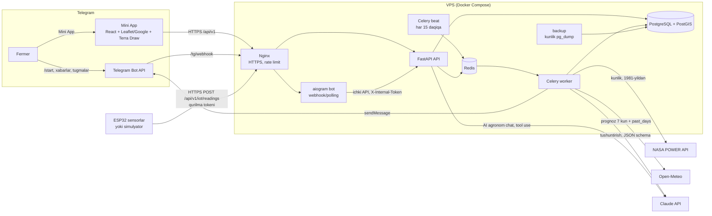
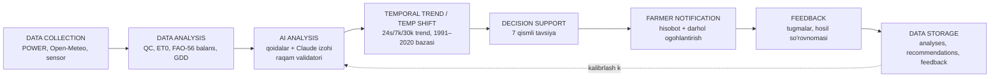
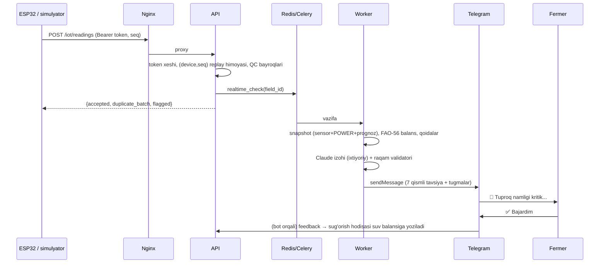
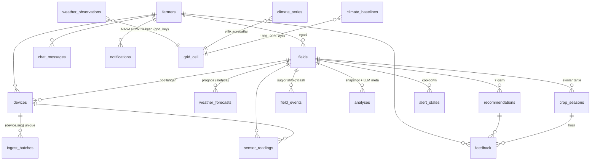

# Arxitektura

## Komponentlar

## AI Agent zanjiri (o'zgartirilmagan tartib)

## "Sensor → ogohlantirish" ketma-ketligi

## Ma'lumotlar modeli (ER, qisqartirilgan)

Asosiy tamoyillar:
- **Raqamlarni kod hisoblaydi, AI tushuntiradi.** LLM'ga faqat `fact_id`li faktlar beriladi; javobdagi har bir raqam validatordan o'tadi, o'tmasa deterministik matn qoladi.
- **Prognoz va kuzatuv alohida** (`weather_forecasts` ↔ `weather_observations`/`sensor_readings`).
- **Har bir qiymat manba, vaqt va fazoviy aniqlik bilan** (snapshot faktlari, UI belgilari).
- **IDOR himoyasi** — barcha so'rovlar egasi bo'yicha filtrlanadi; AI tool'lari `farmer_id` ni modeldan emas, sessiyadan oladi.
- **Bot biznes logikasiz** — faqat backend ichki API'sini chaqiradi.
